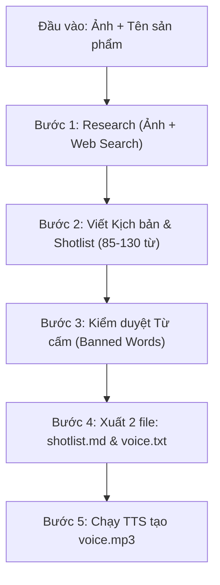

# Quy trình sản xuất Kịch bản & Giọng đọc Video Affiliate

Skill này hướng dẫn quy trình tự động hóa 5 bước từ lúc nhận **hình ảnh sản phẩm** và **tên sản phẩm** (có thể kèm giá hoặc ghi chú) cho đến khi xuất ra kịch bản phân cảnh (`shotlist.md`), văn bản đọc chuẩn hóa (`voice.txt`) và file âm thanh giọng đọc (`voice.mp3`).

---

## Quy trình 5 bước bắt buộc



---

### Bước 1: Phân tích trực quan & Tìm kiếm thông tin thực tế (Research)

1. **Phân tích hình ảnh sản phẩm:**
   - Quan sát kỹ ảnh và trích xuất **ít nhất 3 chi tiết trực quan nhìn thấy rõ** (ví dụ: màu sắc, chất liệu bề mặt nhám/bóng, kiểu dáng bo cong/vuông vức, vị trí nút bấm, cổng cắm sạc, kích thước so với bàn tay, hoặc đóng gói bao bì).
   - **Bắt buộc:** 3 chi tiết này PHẢI xuất hiện tự nhiên trong lời thoại để khi người xem nhìn video quay thật thấy khớp 100% với lời nói.

2. **Tìm kiếm thông tin thực tế (Web Search):**
   - Tìm kiếm công dụng thực tế, thông số nổi bật và mức giá phổ biến trên thị trường.
   - Tìm hiểu sâu về **nỗi đau khách hàng, câu hỏi thường gặp, điểm hay bị hiểu nhầm hoặc lời khen/chê thực tế** của người đã mua.
   - **Tuyệt đối không:** Sao chép nguyên văn văn mẫu mô tả kỹ thuật khô khan từ các shop trên sàn thương mại điện tử.

---

### Bước 2: Xây dựng Kịch bản & Phân cảnh (Shotlist)

1. **Chọn Hook mở đầu:**
   - Đọc file `references/hook-formulas.md`.
   - Chọn **1 công thức Hook** (trong 12 công thức thuộc 5 nhóm) phù hợp nhất với định vị và góc bán của sản phẩm.

2. **Cấu trúc kịch bản chuẩn chuyển đổi (Độ dài: 85 – 130 từ, thời lượng: 30 – 45 giây):**
   - **Hook (0s – 4s):** Câu mở đầu gây tò mò, đánh thẳng nỗi đau hoặc lật ngược kỳ vọng + hành động trực quan giữ chân người lướt.
   - **Nỗi đau / Bối cảnh (4s – 12s):** Mô tả tình huống thực tế thường gặp khiến người xem đồng cảm ("đúng là mình rồi").
   - **Trải nghiệm & Chứng minh (12s – 32s):** Lồng ghép 3 chi tiết nhìn thấy từ ảnh ở Bước 1 cùng 2–3 lợi ích thực tế giải quyết vấn đề.
   - **CTA tự nhiên (32s – 40s):** Kêu gọi hành động nhẹ nhàng, tự nhiên (bấm vào góc trái màn hình / xem giỏ hàng), không hối thúc quá đà.

3. **Văn phong & Độ dài câu:**
   - Nói chuyện như bạn bè chia sẻ trải nghiệm thật (xưng hô: *mình - bạn*, *mình - anh em*, *mình - mọi người* tùy tệp khách).
   - Câu ngắn gọn, mạch lạc, **mỗi câu dưới 18 chữ**.

---

### Bước 3: Kiểm duyệt Từ cấm (Compliance Check)

1. Đối chiếu toàn bộ câu từ kịch bản với bảng quy tắc trong `references/banned-words.md`.
2. Thay thế toàn bộ từ ngữ vi phạm chính sách của TikTok Shop và Shopee Video:
   - **Cam kết tuyệt đối / Phóng đại:** Thay *nhất, 100%, vĩnh viễn, siêu rẻ, sập sàn* bằng *rất ổn trong tầm giá, mình đánh giá cao, giá dễ tiếp cận*.
   - **Y tế / Mỹ phẩm:** Thay *trị dứt điểm, trắng bật tông, tan mỡ, diệt khuẩn 99.9%* bằng *hỗ trợ làm dịu, hỗ trợ làm sáng, giúp bề mặt sạch sẽ*.
   - **Điều hướng nền tảng:** Không nhắc chéo Shopee khi làm clip TikTok và ngược lại; không kêu gọi inbox/Zalo/chuyển khoản; dùng *giỏ hàng góc trái* hoặc *giỏ hàng bên dưới*.
   - **Ngôn từ tiêu cực:** Thay từ kích động, chê bai thô tục bằng cách nói khách quan, nhẹ nhàng.

---

### Bước 4: Xuất 2 file riêng biệt vào thư mục sản phẩm

Tạo thư mục theo slug sản phẩm: `output/<slug-ten-san-pham>/` (ví dụ: `output/quat-mini-cam-tay/`).

1. **File `shotlist.md` (Dành cho quay và dựng video):**
   - Tạo bảng 4 cột chi tiết:
     | Thời gian | Phân đoạn | Gợi ý cảnh quay (Visual) | Lời thoại gốc |
     | :--- | :--- | :--- | :--- |
     | 0s - 4s | Hook | ... | ... |
     | 4s - 12s | Nỗi đau / Bối cảnh | ... | ... |
     | 12s - 32s | Trải nghiệm & Chứng minh | ... | ... |
     | 32s - 40s | Kêu gọi hành động (CTA) | ... | ... |
   - Bên dưới bảng, liệt kê thêm **2 Hook dự phòng** (kèm gợi ý cảnh quay tương ứng) để nhà sáng tạo có thể quay thêm để test A/B.

2. **File `voice.txt` (Dành cho tool TTS):**
   - Chuẩn hóa toàn bộ lời thoại theo nghiêm ngặt quy tắc trong `references/tts-rules.md`.
   - **Thuần văn bản:** Không có Markdown (`*`, `#`, `-`), không có số thứ tự, không có ghi chú cảnh quay `[Cảnh 1]`, không có emoji.
   - Mỗi câu dưới 18 chữ, dùng dấu phẩy để ngắt hơi; xóa dấu ba chấm `...`, dấu gạch ngang `-`.
   - Số, đơn vị đo (`500ml` $\rightarrow$ `500 mi li lít`) và giá tiền (`199k` $\rightarrow$ `một trăm chín mươi chín nghìn`) chuyển hết sang chữ nói.
   - Phiên âm mềm các từ tiếng Anh thông dụng (`Type-C` $\rightarrow$ `tai xi`, `Bluetooth` $\rightarrow$ `bờ lu tút`).
   - Mỗi phân đoạn ý cách nhau 1 dòng trống để giọng đọc tạo khoảng nghỉ tự nhiên.

---

### Bước 5: Chạy Tool Giọng đọc (TTS)

Sau khi lưu file `voice.txt`, tự động chạy script `scripts/generate_voice.py` để sinh file âm thanh `voice.mp3`:

```bash
python scripts/generate_voice.py \
  --input "output/<slug-ten-san-pham>/voice.txt" \
  --output "output/<slug-ten-san-pham>/voice.mp3"
```

> [!NOTE]
> - Nếu môi trường mặc định chưa nhận diện lệnh `python`, sử dụng đường dẫn Python đầy đủ:
>   `D:\hoctap\python\python.exe scripts/generate_voice.py --input "output/<slug-ten-san-pham>/voice.txt" --output "output/<slug-ten-san-pham>/voice.mp3"`
> - Giọng đọc mặc định là nữ (`vi-VN-HoaiMyNeural`), nếu cần giọng nam có thể thêm tham số `--voice "vi-VN-NamMinhNeural"`.
> - Tốc độ đọc mặc định là `--rate "+10%"` giúp video sôi nổi và giữ chân người xem tốt hơn.

---

## Danh mục tài liệu tham khảo

- [hook-formulas.md](file:///D:/hoctap/Affiliate/.agent/skills/affiliate-video-script-voice/references/hook-formulas.md): 12 công thức Hook mở đầu chia theo 5 nhóm kèm Visual.
- [banned-words.md](file:///D:/hoctap/Affiliate/.agent/skills/affiliate-video-script-voice/references/banned-words.md): Bảng đối chiếu từ cấm và từ thay thế an toàn cho TikTok Shop và Shopee Video.
- [tts-rules.md](file:///D:/hoctap/Affiliate/.agent/skills/affiliate-video-script-voice/references/tts-rules.md): Bộ quy tắc chuẩn hóa văn bản dành cho engine TTS.
